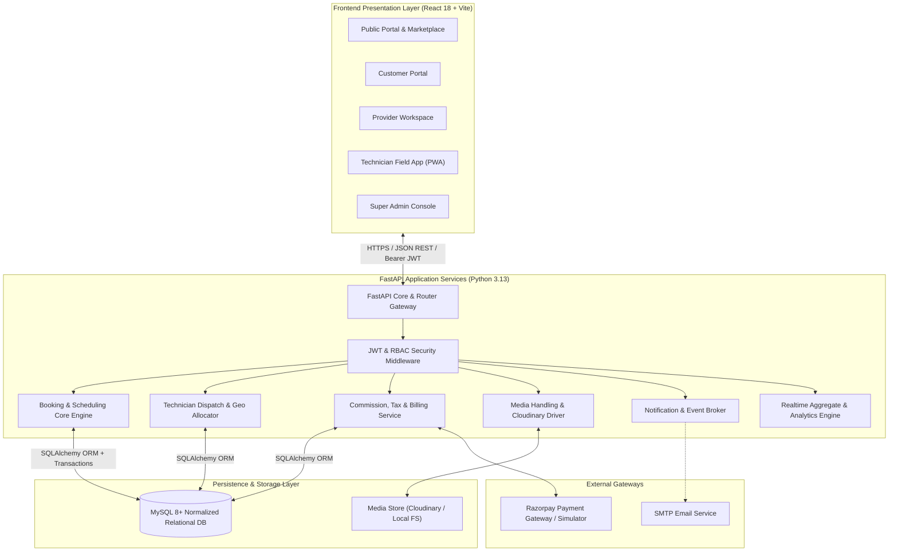
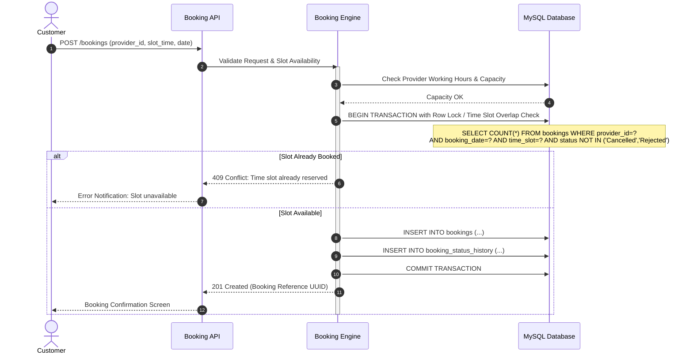
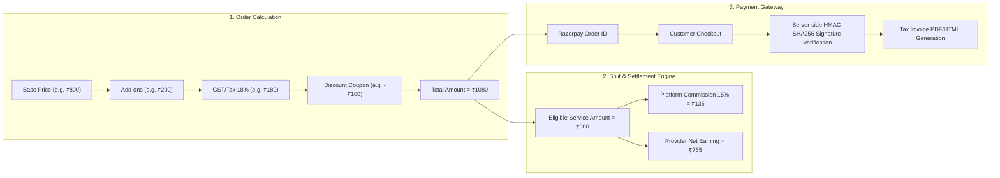

# System Architecture & Technical Design
## HomeServe Technologies – Enterprise SaaS Platform

---

## 1. Architectural Philosophy

HomeServe Technologies is architected as a **Micro-Modular Monolith** designed for high velocity, operational simplicity, and cloud readiness. By pairing a reactive single-page application (React 18 + Vite) with a high-throughput asynchronous Python API (FastAPI) and an ACID-compliant relational persistence store (MySQL 8+), the architecture delivers sub-millisecond response times, absolute data integrity, and strict separation of concerns.

---

## 2. Layered Component Architecture

### 2.1 Presentation Layer (Frontend)
- **Framework**: React 18, Vite build tool.
- **Styling**: Tailwind CSS with enterprise color palettes (slate, deep indigo, royal blue, emerald accents).
- **Icons**: Lucide React.
- **State Management**: React Context & custom hooks for authentication and notifications; localized component state for forms.
- **Forms & Validation**: React Hook Form coupled with Zod schema validation.
- **Data Visualization**: Recharts for dynamic visual dashboards across Admin and Provider portals.
- **HTTP Client**: Axios with centralized request/response interceptors injecting JWT Bearer tokens and uniform error handling.

### 2.2 Application Layer (FastAPI Backend)
- **Framework**: FastAPI (Asynchronous Python 3.13) leveraging Starlette and Pydantic v2.
- **Routing**: Domain-driven modular routers mounted under `/api/v1/`:
  - `/auth`: Registration, login, token refresh, password reset.
  - `/users`: Profile management, addresses.
  - `/categories`: Categories, subcategories, image management.
  - `/services`: Master services, provider catalog offerings.
  - `/providers`: Provider business profiles, verification approvals, working hours.
  - `/technicians`: Technician management, assigned jobs, task completions.
  - `/bookings`: Multi-step booking flow, availability checker, status transitions.
  - `/payments`: Razorpay order creation, payment verification, simulation hooks.
  - `/invoices`: Invoice generation, receipt download.
  - `/reviews`: Review submission, ratings aggregate, provider responses.
  - `/complaints`: Dispute creation, tracking, administrative adjudication.
  - `/notifications`: In-app event delivery, unread counts, mark-as-read.
  - `/analytics`: SQL aggregation queries for admin and provider dashboards.
  - `/admin`: Platform management, user lock/unlock, system announcements.

### 2.3 Data Layer (Persistence)
- **Database Engine**: MySQL 8+ (with universal SQLAlchemy abstraction supporting MySQL 5.1/8 and SQLite).
- **ORM**: SQLAlchemy 2.0 with strict typed mappings and declarative base.
- **Migrations**: Alembic for repeatable, version-controlled schema evolution.
- **Transaction Safety**: Context-managed database sessions (`db.commit()`, `db.rollback()`) ensuring ACID safety for critical operations (e.g., booking confirmation, payment logging, commission splits).

---

## 3. High-Integrity Concurrency & Double-Booking Prevention

To eliminate race conditions and double-booking, HomeServe Technologies utilizes a multi-layered guard strategy:

### Critical Rules Enforced:
1. **Provider Operating Hours Validation**: Bookings outside the provider's active hours are rejected immediately.
2. **Technician Overlap Lock**: When a provider assigns a technician to a booking, the system queries active technician assignments in that time window. If the technician is already committed to an overlapping job, assignment is blocked with an informative error message.
3. **Optimistic & Pessimistic Locking**: Critical status updates check current version/state before transitioning.

---

## 4. Financial & Payment Architecture

### Signature Verification Algorithm
Payment callbacks receive `razorpay_order_id`, `razorpay_payment_id`, and `razorpay_signature`. The backend generates:
$$\text{Expected Signature} = \text{HMAC-SHA256}(\text{order\_id} + "|" + \text{payment\_id}, \text{secret})$$
Payment is marked `Paid` only when `HMAC_COMPARE(Expected, Received) == True`. In development simulation mode, a secured mock flow triggers identical state transitions and invoice generation without external card credentials.

---

## 5. Security & RBAC Architecture

The platform implements multi-tiered defense-in-depth:
- **Authentication**: JWT tokens signed with HS256 algorithm and 24-hour expiration.
- **Authorization**: Granular Role-Based Access Control matrix checked via FastAPI dependency injection:
  - `get_current_user`
  - `get_current_active_user`
  - `require_role(["super_admin"])`
  - `require_role(["service_provider"])`
  - `require_role(["technician"])`
  - `require_role(["customer"])`
- **Ownership Verification**: Endpoints enforce tenant isolation (e.g., customers cannot read other customers' bookings, providers cannot see competing providers' revenues).
- **Audit Trails**: Every lifecycle change creates timestamped records in `booking_status_history` and `complaint_history`.
