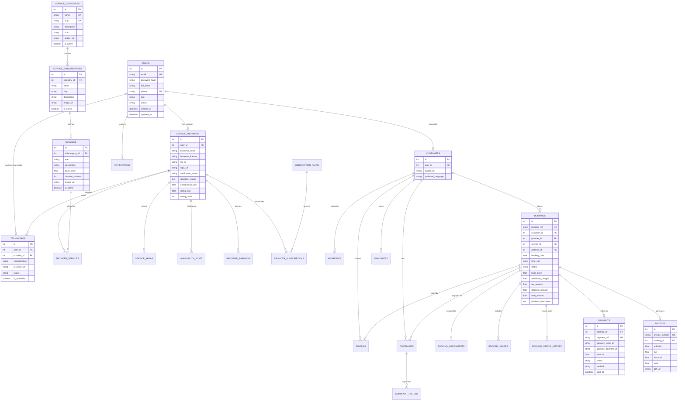

# Database Architecture & Entity-Relationship (ER) Specifications
## HomeServe Technologies – Relational Schema Design

---

## 1. Schema Overview

The database design adheres strictly to Third Normal Form (3NF), enforcing referential integrity, primary/foreign key indexing, soft-deletion timestamps, audit logging, and concurrency control locks. It defines 27 distinct relational tables catering to users, multi-vendor providers, service hierarchies, bookings, technicians, payments, invoices, notifications, complaints, and analytics.

---

## 2. Mermaid Entity-Relationship Diagram

---

## 3. Table Schema Specifications (27 Tables)

### Table 1: `users`
- `id` (INT, PK, Auto Increment)
- `email` (VARCHAR(191), Unique, Indexed)
- `password_hash` (VARCHAR(255), Not Null)
- `full_name` (VARCHAR(150), Not Null)
- `phone` (VARCHAR(30), Unique, Nullable)
- `role` (VARCHAR(30), Enum: `super_admin`, `customer`, `service_provider`, `technician`, Default: `customer`)
- `status` (VARCHAR(20), Enum: `active`, `inactive`, `suspended`, Default: `active`)
- `created_at` (DATETIME, Default: CURRENT_TIMESTAMP)
- `updated_at` (DATETIME, Default: CURRENT_TIMESTAMP ON UPDATE CURRENT_TIMESTAMP)

### Table 2: `customers`
- `id` (INT, PK, Auto Increment)
- `user_id` (INT, FK -> users.id, Unique, Cascade Delete)
- `avatar_url` (VARCHAR(500), Nullable)
- `emergency_contact` (VARCHAR(30), Nullable)
- `created_at` (DATETIME)

### Table 3: `service_providers`
- `id` (INT, PK, Auto Increment)
- `user_id` (INT, FK -> users.id, Unique, Cascade Delete)
- `business_name` (VARCHAR(200), Not Null)
- `business_registration_number` (VARCHAR(100), Nullable)
- `tax_id` (VARCHAR(100), Nullable)
- `business_bio` (TEXT, Nullable)
- `logo_url` (VARCHAR(500), Nullable)
- `banner_url` (VARCHAR(500), Nullable)
- `verification_status` (VARCHAR(20), Enum: `pending`, `verified`, `rejected`, Default: `pending`)
- `verification_document_url` (VARCHAR(500), Nullable)
- `rejection_reason` (TEXT, Nullable)
- `commission_rate` (DECIMAL(5,2), Default: 15.00)
- `rating_avg` (DECIMAL(3,2), Default: 5.00)
- `rating_count` (INT, Default: 0)
- `is_available` (BOOLEAN, Default: TRUE)
- `created_at` (DATETIME)
- `updated_at` (DATETIME)

### Table 4: `technicians`
- `id` (INT, PK, Auto Increment)
- `user_id` (INT, FK -> users.id, Unique, Cascade Delete)
- `provider_id` (INT, FK -> service_providers.id, Cascade Delete, Indexed)
- `specialization` (VARCHAR(150), Nullable)
- `id_proof_url` (VARCHAR(500), Nullable)
- `status` (VARCHAR(20), Enum: `active`, `inactive`, `on_leave`, Default: `active`)
- `is_available` (BOOLEAN, Default: TRUE)
- `created_at` (DATETIME)

### Table 5: `addresses`
- `id` (INT, PK, Auto Increment)
- `customer_id` (INT, FK -> customers.id, Cascade Delete, Indexed)
- `title` (VARCHAR(50), Default: 'Home')
- `address_line1` (VARCHAR(255), Not Null)
- `address_line2` (VARCHAR(255), Nullable)
- `city` (VARCHAR(100), Not Null)
- `state` (VARCHAR(100), Not Null)
- `postal_code` (VARCHAR(20), Not Null)
- `latitude` (DECIMAL(10,8), Nullable)
- `longitude` (DECIMAL(11,8), Nullable)
- `is_default` (BOOLEAN, Default: FALSE)
- `created_at` (DATETIME)

### Table 6: `service_categories`
- `id` (INT, PK, Auto Increment)
- `name` (VARCHAR(100), Unique, Not Null)
- `slug` (VARCHAR(120), Unique, Not Null)
- `description` (TEXT, Nullable)
- `icon` (VARCHAR(50), Nullable)
- `image_url` (VARCHAR(500), Nullable)
- `is_active` (BOOLEAN, Default: TRUE)
- `display_order` (INT, Default: 0)
- `created_at` (DATETIME)

### Table 7: `service_subcategories`
- `id` (INT, PK, Auto Increment)
- `category_id` (INT, FK -> service_categories.id, Cascade Delete, Indexed)
- `name` (VARCHAR(120), Not Null)
- `slug` (VARCHAR(150), Unique, Not Null)
- `description` (TEXT, Nullable)
- `image_url` (VARCHAR(500), Nullable)
- `is_active` (BOOLEAN, Default: TRUE)
- `display_order` (INT, Default: 0)
- `created_at` (DATETIME)

### Table 8: `services`
- `id` (INT, PK, Auto Increment)
- `subcategory_id` (INT, FK -> service_subcategories.id, Cascade Delete, Indexed)
- `title` (VARCHAR(200), Not Null)
- `slug` (VARCHAR(220), Unique, Not Null)
- `description` (TEXT, Nullable)
- `base_price` (DECIMAL(10,2), Not Null)
- `duration_minutes` (INT, Default: 60)
- `image_url` (VARCHAR(500), Nullable)
- `is_active` (BOOLEAN, Default: TRUE)
- `created_at` (DATETIME)

### Table 9: `provider_services`
- `id` (INT, PK, Auto Increment)
- `provider_id` (INT, FK -> service_providers.id, Cascade Delete)
- `service_id` (INT, FK -> services.id, Cascade Delete)
- `custom_price` (DECIMAL(10,2), Nullable)
- `is_enabled` (BOOLEAN, Default: TRUE)
- `created_at` (DATETIME)
- *Unique Constraint*: `(provider_id, service_id)`

### Table 10: `service_areas`
- `id` (INT, PK, Auto Increment)
- `provider_id` (INT, FK -> service_providers.id, Cascade Delete, Indexed)
- `city` (VARCHAR(100), Not Null)
- `postal_code` (VARCHAR(20), Not Null)
- `radius_km` (DECIMAL(5,2), Default: 15.00)
- `created_at` (DATETIME)

### Table 11: `availability_slots`
- `id` (INT, PK, Auto Increment)
- `provider_id` (INT, FK -> service_providers.id, Cascade Delete, Indexed)
- `day_of_week` (INT, 0=Monday ... 6=Sunday)
- `start_time` (VARCHAR(10), Default: '09:00')
- `end_time` (VARCHAR(10), Default: '18:00')
- `slot_duration_minutes` (INT, Default: 60)
- `is_active` (BOOLEAN, Default: TRUE)

### Table 12: `bookings`
- `id` (INT, PK, Auto Increment)
- `booking_ref` (VARCHAR(60), Unique, Indexed)
- `customer_id` (INT, FK -> customers.id, Indexed)
- `provider_id` (INT, FK -> service_providers.id, Indexed)
- `service_id` (INT, FK -> services.id, Indexed)
- `address_id` (INT, FK -> addresses.id)
- `booking_date` (DATE, Not Null, Indexed)
- `time_slot` (VARCHAR(30), Not Null)
- `status` (VARCHAR(30), Enum: `Pending`, `Confirmed`, `Provider Assigned`, `In Progress`, `Completed`, `Cancelled`, `Rejected`, Default: `Pending`, Indexed)
- `base_price` (DECIMAL(10,2), Not Null)
- `additional_charges` (DECIMAL(10,2), Default: 0.00)
- `tax_amount` (DECIMAL(10,2), Default: 0.00)
- `discount_amount` (DECIMAL(10,2), Default: 0.00)
- `total_amount` (DECIMAL(10,2), Not Null)
- `problem_description` (TEXT, Nullable)
- `created_at` (DATETIME, Default: CURRENT_TIMESTAMP)
- `updated_at` (DATETIME, Default: CURRENT_TIMESTAMP ON UPDATE CURRENT_TIMESTAMP)

### Table 13: `booking_assignments`
- `id` (INT, PK, Auto Increment)
- `booking_id` (INT, FK -> bookings.id, Cascade Delete, Indexed)
- `technician_id` (INT, FK -> technicians.id, Indexed)
- `assigned_by` (INT, FK -> users.id)
- `assigned_at` (DATETIME, Default: CURRENT_TIMESTAMP)
- `technician_acknowledged` (BOOLEAN, Default: FALSE)
- `arrival_time` (DATETIME, Nullable)
- `work_started_time` (DATETIME, Nullable)
- `work_completed_time` (DATETIME, Nullable)
- `completion_remarks` (TEXT, Nullable)

### Table 14: `booking_images`
- `id` (INT, PK, Auto Increment)
- `booking_id` (INT, FK -> bookings.id, Cascade Delete, Indexed)
- `image_type` (VARCHAR(30), Enum: `customer_reference`, `before_service`, `after_service`)
- `image_url` (VARCHAR(500), Not Null)
- `uploaded_by` (INT, FK -> users.id)
- `created_at` (DATETIME)

### Table 15: `booking_status_history`
- `id` (INT, PK, Auto Increment)
- `booking_id` (INT, FK -> bookings.id, Cascade Delete, Indexed)
- `previous_status` (VARCHAR(30), Nullable)
- `new_status` (VARCHAR(30), Not Null)
- `changed_by_user_id` (INT, FK -> users.id)
- `notes` (TEXT, Nullable)
- `created_at` (DATETIME, Default: CURRENT_TIMESTAMP)

### Table 16: `payments`
- `id` (INT, PK, Auto Increment)
- `booking_id` (INT, FK -> bookings.id, Cascade Delete, Indexed)
- `payment_ref` (VARCHAR(100), Unique, Indexed)
- `gateway` (VARCHAR(50), Default: 'razorpay')
- `gateway_order_id` (VARCHAR(120), Nullable)
- `gateway_payment_id` (VARCHAR(120), Nullable)
- `gateway_signature` (VARCHAR(255), Nullable)
- `amount` (DECIMAL(10,2), Not Null)
- `currency` (VARCHAR(10), Default: 'INR')
- `status` (VARCHAR(20), Enum: `Pending`, `Paid`, `Failed`, `Refunded`, Default: `Pending`)
- `payment_method` (VARCHAR(50), Nullable)
- `paid_at` (DATETIME, Nullable)
- `created_at` (DATETIME)

### Table 17: `invoices`
- `id` (INT, PK, Auto Increment)
- `invoice_number` (VARCHAR(60), Unique, Indexed)
- `booking_id` (INT, FK -> bookings.id, Unique)
- `customer_name` (VARCHAR(150), Not Null)
- `provider_name` (VARCHAR(200), Not Null)
- `subtotal` (DECIMAL(10,2), Not Null)
- `tax_amount` (DECIMAL(10,2), Not Null)
- `discount_amount` (DECIMAL(10,2), Default: 0.00)
- `total_amount` (DECIMAL(10,2), Not Null)
- `pdf_url` (VARCHAR(500), Nullable)
- `created_at` (DATETIME)

### Table 18: `coupons`
- `id` (INT, PK, Auto Increment)
- `code` (VARCHAR(40), Unique, Not Null)
- `description` (VARCHAR(255), Nullable)
- `discount_type` (VARCHAR(20), Enum: `percentage`, `fixed`)
- `discount_value` (DECIMAL(10,2), Not Null)
- `min_order_amount` (DECIMAL(10,2), Default: 0.00)
- `max_discount` (DECIMAL(10,2), Nullable)
- `valid_until` (DATETIME, Nullable)
- `is_active` (BOOLEAN, Default: TRUE)
- `created_at` (DATETIME)

### Table 19: `reviews`
- `id` (INT, PK, Auto Increment)
- `booking_id` (INT, FK -> bookings.id, Unique)
- `customer_id` (INT, FK -> customers.id, Indexed)
- `provider_id` (INT, FK -> service_providers.id, Indexed)
- `rating` (INT, Not Null)
- `comment` (TEXT, Nullable)
- `provider_reply` (TEXT, Nullable)
- `replied_at` (DATETIME, Nullable)
- `created_at` (DATETIME)

### Table 20: `complaints`
- `id` (INT, PK, Auto Increment)
- `ticket_number` (VARCHAR(50), Unique, Indexed)
- `booking_id` (INT, FK -> bookings.id, Indexed)
- `customer_id` (INT, FK -> customers.id, Indexed)
- `subject` (VARCHAR(200), Not Null)
- `description` (TEXT, Not Null)
- `attachment_url` (VARCHAR(500), Nullable)
- `status` (VARCHAR(30), Enum: `Open`, `Under Review`, `In Progress`, `Resolved`, `Closed`, Default: `Open`, Indexed)
- `resolution_remarks` (TEXT, Nullable)
- `created_at` (DATETIME)
- `updated_at` (DATETIME)

### Table 21: `complaint_history`
- `id` (INT, PK, Auto Increment)
- `complaint_id` (INT, FK -> complaints.id, Cascade Delete, Indexed)
- `previous_status` (VARCHAR(30), Nullable)
- `new_status` (VARCHAR(30), Not Null)
- `remarks` (TEXT, Nullable)
- `updated_by_user_id` (INT, FK -> users.id)
- `created_at` (DATETIME)

### Table 22: `notifications`
- `id` (INT, PK, Auto Increment)
- `user_id` (INT, FK -> users.id, Cascade Delete, Indexed)
- `title` (VARCHAR(150), Not Null)
- `message` (TEXT, Not Null)
- `event_type` (VARCHAR(60), Not Null)
- `reference_id` (VARCHAR(60), Nullable)
- `is_read` (BOOLEAN, Default: FALSE, Indexed)
- `created_at` (DATETIME, Default: CURRENT_TIMESTAMP)

### Table 23: `provider_earnings`
- `id` (INT, PK, Auto Increment)
- `provider_id` (INT, FK -> service_providers.id, Cascade Delete, Indexed)
- `booking_id` (INT, FK -> bookings.id, Unique)
- `gross_amount` (DECIMAL(10,2), Not Null)
- `commission_rate` (DECIMAL(5,2), Not Null)
- `commission_amount` (DECIMAL(10,2), Not Null)
- `net_amount` (DECIMAL(10,2), Not Null)
- `payout_status` (VARCHAR(20), Enum: `Pending`, `Settled`, Default: `Pending`)
- `settled_at` (DATETIME, Nullable)
- `created_at` (DATETIME)

### Table 24: `favourites`
- `id` (INT, PK, Auto Increment)
- `customer_id` (INT, FK -> customers.id, Cascade Delete)
- `provider_id` (INT, FK -> service_providers.id, Cascade Delete)
- `created_at` (DATETIME)
- *Unique Constraint*: `(customer_id, provider_id)`

### Table 25: `subscription_plans`
- `id` (INT, PK, Auto Increment)
- `name` (VARCHAR(100), Not Null)
- `price` (DECIMAL(10,2), Not Null)
- `duration_days` (INT, Default: 30)
- `max_technicians` (INT, Default: 5)
- `features_json` (TEXT, Nullable)
- `is_active` (BOOLEAN, Default: TRUE)

### Table 26: `provider_subscriptions`
- `id` (INT, PK, Auto Increment)
- `provider_id` (INT, FK -> service_providers.id, Cascade Delete, Indexed)
- `plan_id` (INT, FK -> subscription_plans.id)
- `start_date` (DATETIME, Not Null)
- `end_date` (DATETIME, Not Null)
- `status` (VARCHAR(20), Enum: `active`, `expired`, `cancelled`, Default: `active`)

### Table 27: `admin_announcements`
- `id` (INT, PK, Auto Increment)
- `title` (VARCHAR(200), Not Null)
- `content` (TEXT, Not Null)
- `target_audience` (VARCHAR(30), Enum: `all`, `customers`, `providers`, `technicians`, Default: `all`)
- `is_active` (BOOLEAN, Default: TRUE)
- `created_at` (DATETIME)
- `created_by` (INT, FK -> users.id)

