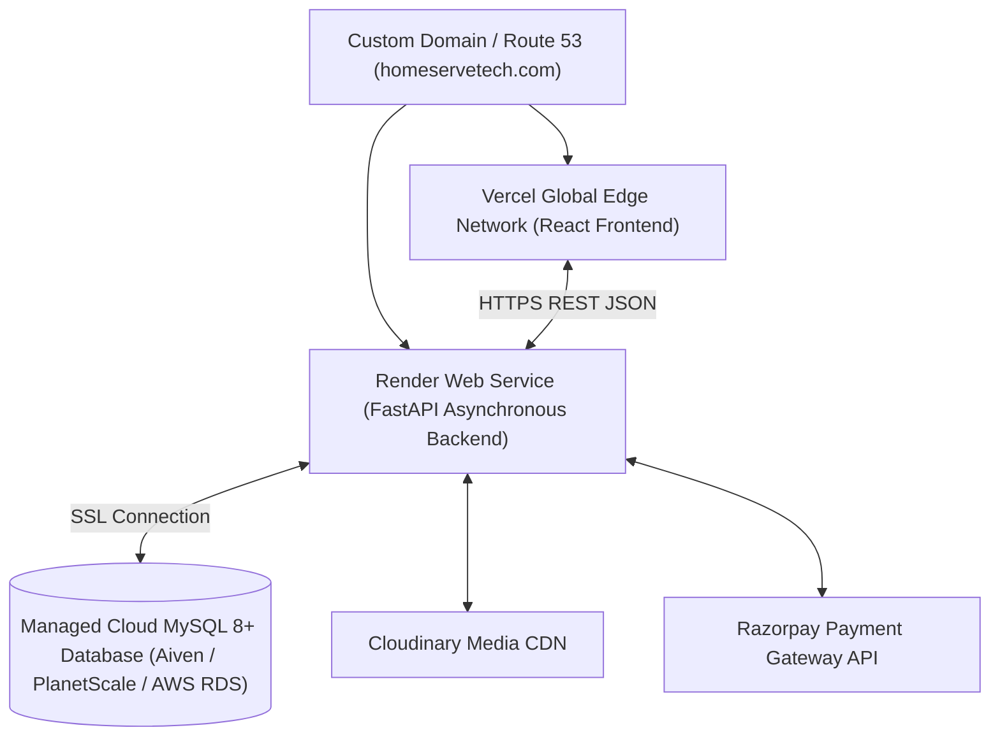

# Production Cloud Deployment Guide
## HomeServe Technologies – Multi-Vendor SaaS Platform

---

## 1. Cloud Architecture Overview



---

## 2. Frontend Deployment on Netlify (or Vercel)

### Option A: Netlify (User Selected)
1. Log in to [Netlify](https://app.netlify.com).
2. Click **"Add new site"** -> **"Import an existing project"** -> **"GitHub"**.
3. Select your repository: `rahulsanghavi4321/vibe-coding`.
4. Configure Build settings:
   - **Base directory**: `frontend`
   - **Build command**: `npm run build`
   - **Publish directory**: `dist` (or `frontend/dist`)
5. Configure Environment Variables in Netlify (**Site configuration** -> **Environment variables**):
   ```env
   VITE_API_URL = https://<your-render-backend-name>.onrender.com/api/v1
   ```
6. Click **"Deploy site"**. Netlify automatically uses `frontend/netlify.toml` and `frontend/public/_redirects` to ensure seamless SPA client-side routing across all dashboard routes without 404 errors.

### Option B: Vercel
1. Link GitHub repository `rahulsanghavi4321/vibe-coding` on Vercel.
2. Root Directory: `frontend`.
3. Set `VITE_API_URL` to your Render API URL.
4. Deploy using `frontend/vercel.json`.

---

## 3. Backend Deployment on Render

1. **Create Web Service**:
   - In Render Dashboard, click **New + Web Service**.
   - Select repository: `homeserve-technologies-saas`.
   - Set **Root Directory**: `backend`.
2. **Build & Runtime Configuration**:
   - Runtime: `Python 3`.
   - Build Command: `pip install -r requirements.txt`.
   - Start Command: `uvicorn app.main:app --host 0.0.0.0 --port $PORT`.
3. **Environment Variables**:
   ```env
   APP_NAME="HomeServe Technologies"
   APP_ENV=production
   APP_DEBUG=false
   SECRET_KEY=your_generated_32_char_production_jwt_secret
   DATABASE_URL=mysql+pymysql://<user>:<password>@<cloud-mysql-host>:3306/homeserve_db?charset=utf8
   PAYMENT_MODE=simulation # switch to test/live once gateway approved
   MEDIA_STORAGE_DRIVER=local
   ```
4. **Health Check Verification**:
   - Set health check path to `/health`.
   - Verify deployment returns `HTTP 200 {"status": "ok"}`.

---

## 4. Managed Cloud Database Setup (Aiven / AWS RDS)

1. **Provision MySQL Instance**:
   - Deploy MySQL 8.0 instance on Aiven or AWS RDS.
   - Note connection URI: `mysql+pymysql://<user>:<password>@<host>:3306/homeserve_db?charset=utf8`.
2. **Execute Seed Migration**:
   - Run the seeder from Render shell or CI/CD:
     ```bash
     python -m app.utils.seed
     ```
   - Verifies 27 tables and baseline catalog.

---

## 5. Production Verification Checklist

- [x] Public Homepage & Categories load dynamically from MySQL.
- [x] Customer Registration & JWT Login generate valid sessions.
- [x] Super Admin Dashboard displays live SQL aggregate metrics.
- [x] Service Provider can accept bookings and dispatch available technicians.
- [x] Technician Field App transitions jobs to `In Progress` and `Completed`.
- [x] Payment sandbox verifies signatures and automatically issues tax invoices.
- [x] Pytest suite passes 11/11 tests.
- [x] OpenAPI Swagger documentation accessible at `/docs`.

