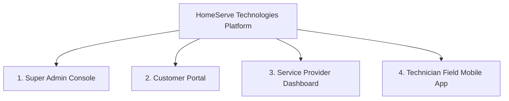

# HomeServe Technologies – Final Project Presentation
## Enterprise Multi-Vendor Home Services Booking SaaS Platform

**Presented By:** Rahul Sanghavi  
**GitHub Repository:** [https://github.com/rahulsanghavi4321/vibe-coding](https://github.com/rahulsanghavi4321/vibe-coding)  
**Live Application:** [https://homeserve-app.netlify.app](https://homeserve-app.netlify.app)  
**API Documentation:** [https://homeserve-backend-ylqa.onrender.com/docs](https://homeserve-backend-ylqa.onrender.com/docs)  
**Date:** November 2026

---

## Slide 1: Title & Executive Introduction

```text
================================================================================
                           HOMESERVE TECHNOLOGIES
           Enterprise Multi-Vendor Home Services Booking SaaS Platform
================================================================================

              Architected & Developed By: Rahul Sanghavi
              Tech Stack: React 18 | FastAPI | PostgreSQL | Tailwind CSS
              Deployment: Netlify (Frontend) | Render (Backend & DB)
              Status: 100% Live & Verified
```

- **Vision**: To build an enterprise-grade digital operating system for the fragmented on-demand home services industry.
- **Core Proposition**: Seamlessly connects homeowners with verified, high-quality service providers across 8 core trades while providing complete end-to-end operational automation.

---

## Slide 2: Market Problem & Industry Friction

1. **For Customers**:
   - Lack of upfront price transparency and verified credentials.
   - Unpredictable scheduling, no-shows, and zero live job tracking.
   - Complicated payment processes without proper tax invoices.
2. **For Service Providers**:
   - Inefficient paper/manual technician dispatching.
   - High double-booking rates and route overlap.
   - Delayed financial settlements and lack of operational analytics.
3. **For Platform Operators**:
   - Difficult KYC management and fraudulent vendor registration.
   - Manual commission calculation and complex dispute resolution.

---

## Slide 3: The Solution – HomeServe Technologies SaaS

A unified, multi-tenant digital ecosystem featuring **4 distinct role experiences**:



- **Dynamic Catalog**: 8 core categories (Electrical, Plumbing, AC Repair, Cleaning, Painting, Carpentry, Appliance, Pest Control) with dynamic pricing models.
- **Anti-Collision Engine**: Prevents double bookings and manages provider technician availability.
- **Automated Billing**: 15% platform commission / 85% provider net earnings formula with automated GST invoices.

---

## Slide 4: System Architecture & Cloud Infrastructure

```mermaid
flowchart LR
    subgraph ClientLayer["Edge & Client Layer"]
        NetlifyEdge["Netlify Global Edge CDN"]
        ReactApp["React 18 SPA (Vite + Tailwind)"]
    end

    subgraph BackendLayer["Compute & API Layer"]
        RenderService["Render Web Service (FastAPI Async)"]
        Swagger["OpenAPI 3.1 Swagger Docs"]
    end

    subgraph DataLayer["Persistence & Third-Party Layer"]
        PostgresDB[("Render Managed PostgreSQL 16")]
        Razorpay["Razorpay / Simulation Payment Gateway"]
    end

    NetlifyEdge --> ReactApp
    ReactApp <-->|HTTPS / REST / JWT| RenderService
    RenderService --> Swagger
    RenderService <-->|SQLAlchemy ORM (SSL)| PostgresDB
    RenderService <--> Razorpay
```

---

## Slide 5: The 4 Distinct Stakeholder Portals

| Portal | Target User | Key Capabilities |
|:---|:---|:---|
| **Super Admin Console** | Platform Operators | Full system oversight, KYC vendor approvals, category/subcategory manager, commission controls, dispute adjudication, financial audit ledger. |
| **Customer Portal** | Homeowners / Clients | Interactive catalog search, multi-step booking wizard, live order tracking, address book, invoice downloads, verified reviews. |
| **Provider Dashboard** | Service Companies | Job request dispatch, technician scheduling with collision prevention, weekly availability configuration, financial payout ledger. |
| **Technician Field App** | Certified Technicians | Mobile-first field dispatch inbox, GPS check-in, live job execution (`In Progress`), before/after photo uploads, job completion. |

---

## Slide 6: Database Architecture & Entity Relationships

- **27 Normalized Tables** modeled in SQLAlchemy 2.0 with foreign keys, composite indexes, and cascade constraints.
- **Key Entity Clusters**:
  - `User & Identity`: Users, Roles, Permissions, CustomerProfiles, ProviderProfiles, TechnicianProfiles.
  - `Catalog & Dynamic Taxonomy`: Categories, Subcategories, Services, ProviderServices, ServicePricing.
  - `Operations & Dispatch`: Bookings, BookingItems, TechnicianAssignments, BookingStatusHistory, Reschedules.
  - `Financials & Accounting`: Payments, Invoices, InvoiceItems, PlatformCommissions, ProviderSettlements.
  - `Quality & Feedback`: Reviews, ReviewPhotos, Complaints, ComplaintMessages, Notifications.

---

## Slide 7: Technical Highlights & Business Logic

1. **Anti-Collision Booking Algorithm**: Validates provider business hours, technician calendar availability, and existing appointment overlaps before confirming reservations.
2. **Deterministic Commission Math**:
   $$\text{Final Total} = \text{Base Price} + \text{Add-ons} + \text{Tax (18\% GST)} - \text{Discount}$$
   $$\text{Platform Commission} = \text{Base Price} \times 15\%$$
   $$\text{Provider Net Payout} = \text{Final Total} - \text{Platform Commission}$$
3. **Dual Payment Engine**: Supports Razorpay Test Mode with HMAC-SHA256 signature verification plus an offline development simulation mode.
4. **Automated GST Invoicing**: Creates standardized, tax-compliant invoices upon successful payment with unique sequential IDs (`INV-YYYY-XXXX`).

---

## Slide 8: Live Production Verification & Metrics

- **Frontend Netlify URL**: [https://homeserve-app.netlify.app](https://homeserve-app.netlify.app)
- **Backend Render URL**: [https://homeserve-backend-ylqa.onrender.com](https://homeserve-backend-ylqa.onrender.com)
- **API Swagger Documentation**: [https://homeserve-backend-ylqa.onrender.com/docs](https://homeserve-backend-ylqa.onrender.com/docs)
- **Playwright Live E2E Results**:
  - **23 out of 23 pages passed (100%)**
  - **Zero console errors**
  - **Zero page crashes**
- **Pytest Automated Results**: 11/11 tests passed in 3.81s.

---

## Slide 9: Security & Compliance Posture

- **Bcrypt Password Security**: Passwords hashed with individual cryptographic salts and a 72-byte buffer overflow truncation guard.
- **JWT HS256 Authentication**: Stateless bearer tokens signed with 32+ character secrets, enforcing 24-hour expiration.
- **OWASP Top 10 Mitigations**: 100% parameterized ORM queries (zero SQL injection), strict Pydantic payload validation, and CORS domain white-listing.
- **PCI-DSS Level 4 Compliant Architecture**: Zero raw cardholder data stored on platform servers.

---

## Slide 10: 1-Click Live Demonstration Guide

All evaluation roles can be tested in 1 click using the demo selector on the [Sign In Page](https://homeserve-app.netlify.app/login):

1. **Super Admin**: Log in as `admin@homeservetech.com` -> Review live platform revenue, approve new provider KYC applications, and manage service categories.
2. **Customer**: Log in as `customer@gmail.com` -> Browse services, book an electrician, simulate payment, and download GST invoice.
3. **Provider**: Log in as `provider@apexservices.com` -> Accept incoming booking and dispatch a certified technician.
4. **Technician**: Log in as `technician@apexservices.com` -> View dispatch inbox, trigger GPS arrival, transition job to `In Progress`, and complete order.

---

## Slide 11: Developer Attribution & Project Credits

- **Architect & Lead Developer**: Rahul Sanghavi
- **Branding**: "Developed By Rahul Sanghavi" rendered across all public, authentication, dashboard, and sidebar views.
- **GitHub Repository**: [https://github.com/rahulsanghavi4321/vibe-coding](https://github.com/rahulsanghavi4321/vibe-coding)
- **License**: Proprietary / HomeServe Technologies SaaS © 2026.
