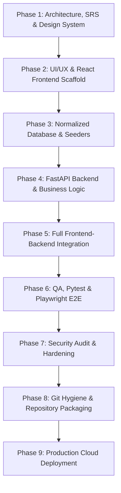

# Implementation Roadmap & SDLC Execution Plan
## HomeServe Technologies – 9-Phase Structured Delivery

---

## Executive Summary

To guarantee commercial enterprise quality without untested code sprawl, the development follows a strictly sequential 9-phase execution methodology. Each phase concludes with explicit verification gates before proceeding.

---

## Detailed Phase Breakdown

### Phase 1 – Requirement Analysis, Architecture & Design System (Current)
- **Deliverables**: SRS document, High-Level Architecture, Role-Permission Matrix, 27-table ER Diagram, Folder Map, UI/UX Design System, Roadmap.
- **Verification Gate**:
  - All 8 categories and business models mapped.
  - Concurrency & double booking prevention rules formulated.
  - Phase 1 documentation reviewed and recorded in `PROJECT_STATUS.md`.

### Phase 2 – UI/UX & React Frontend Development
- **Deliverables**:
  - Vite + React 18 + Tailwind CSS setup.
  - Responsive design system with Lucide icons & Recharts.
  - Public marketing pages (Landing, About, Services, How It Works, Auth).
  - 4 Role-based dashboards with functional navigation, stats cards, modals, tables, and forms:
    1. Super Admin Dashboard (Analytics, Categories, Providers, Dispute Console).
    2. Customer Dashboard & Interactive Booking Wizard (Category -> Service -> Provider -> Date/Time Slot -> Address -> Notes -> Photo -> Payment).
    3. Service Provider Dashboard (Requests, Calendar, Technician Dispatch, Commission/Revenue).
    4. Mobile-first Technician Dashboard (Job details, Arrival trigger, Before/After photo upload).
- **Verification Gate**:
  - Zero console errors; clean mobile/tablet/desktop responsive layouts; interactive mock states for all buttons and tabs.

### Phase 3 – Database Design & Migrations
- **Deliverables**:
  - SQLAlchemy 2.0 ORM models for all 27 tables.
  - Automated database initialization script (`reset_db.py`).
  - Baseline seed data generator populating 8 categories, 24+ subcategories, 48+ services, verified providers, technicians, and demo users.
- **Verification Gate**:
  - Successful table creation and relationship resolution against MySQL (`homeserve_db`).
  - Foreign key cascades and unique constraints verified.

### Phase 4 – Backend REST API Development (FastAPI)
- **Deliverables**:
  - FastAPI application factory with CORS and global error handlers.
  - JWT authentication (`/api/v1/auth`) with bcrypt password hashing and RBAC dependencies.
  - Routers: Categories, Services, Providers, Technicians, Bookings, Payments, Invoices, Reviews, Complaints, Notifications, Analytics.
  - Anti-collision booking engine with transaction rollbacks.
  - Dual-mode Payment Engine (Razorpay Test Mode + Dev Simulation).
  - Automated Swagger UI (`/docs`) and OpenAPI spec (`/openapi.json`).
- **Verification Gate**:
  - Interactive test of all API routes in Swagger UI; successful JWT issue and verification.

### Phase 5 – Frontend-Backend Integration
- **Deliverables**:
  - Axios HTTP client configured with JWT interceptors.
  - React Context linking authentication, profile state, and notifications.
  - Dynamic category & service rendering from database.
  - End-to-end booking execution, technician assignment, and status timeline.
  - Seamless payment simulation and invoice viewing.
  - Dynamic Recharts analytics fed by live SQL queries.
- **Verification Gate**:
  - Zero hardcoded numbers; full roundtrip from customer booking to admin analytics.

### Phase 6 – Software Testing & Quality Assurance
- **Deliverables**:
  - Pytest unit and integration test suite covering auth, booking logic, commission math, and availability.
  - Postman API collection and environment JSON file.
  - Playwright automated end-to-end test suite executing the 18-step golden booking journey and negative collision tests.
- **Verification Gate**:
  - 100% test pass rate recorded with execution logs.

### Phase 7 – Security Implementation & Hardening
- **Deliverables**:
  - RBAC verification across all API endpoints.
  - File upload sanitization (size checks, MIME type restrictions).
  - SQL injection and XSS defenses verified.
  - Payment signature cryptographic verification.
  - Comprehensive Security Checklist artifact.
- **Verification Gate**:
  - Unauthenticated or cross-role access attempts strictly return 401/403.

### Phase 8 – Version Control & Packaging
- **Deliverables**:
  - Clean Git commit history on `main` and `development`.
  - Comprehensive `README.md` with startup commands, architecture diagrams, and API guides.
  - `docker-compose.yml` for unified one-command orchestration.
- **Verification Gate**:
  - Fresh clone builds and boots with zero missing dependencies.

### Phase 9 – Production Deployment Readiness
- **Deliverables**:
  - Vercel deployment configuration for frontend (`vercel.json`).
  - Render deployment configuration for backend (`render.yaml`).
  - Production environment variable guide and health-check monitoring endpoint (`/health`).
  - Final delivery documentation and verification report.
- **Verification Gate**:
  - Production builds verified with clean build artifacts.

