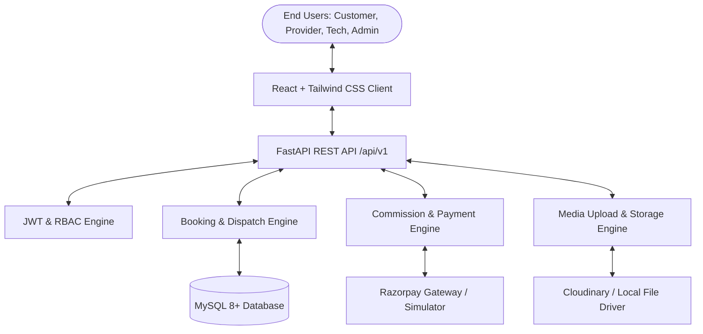

# Software Requirements Specification (SRS)
## HomeServe Technologies – Multi-Vendor Home Services SaaS Platform
**Version:** 1.0.0  
**Status:** Approved  
**Date:** November 2026  

---

## 1. Introduction

### 1.1 Purpose
This document specifies the software requirements for **HomeServe Technologies**, a multi-vendor Software-as-a-Service (SaaS) platform that connects residential and commercial customers with verified professional home service providers and technicians. It details functional and non-functional requirements, user personas, operational constraints, and domain business rules.

### 1.2 Scope
HomeServe Technologies provides a digital marketplace and operational engine for:
- **Customers**: Discovering certified local home service providers, comparing prices and ratings, booking scheduled appointments, making online payments, tracking technicians, and managing reviews.
- **Service Providers**: Managing corporate profiles, listing service offerings and pricing, managing service areas, receiving and confirming bookings, dispatching technicians, and tracking revenues.
- **Technicians**: Executing assigned jobs, navigating to service addresses, recording job status transitions, uploading before/after proof-of-work media, and closing tickets.
- **Super Admin**: Overseeing system integrity, verifying service providers and KYC documents, managing dynamic categories and platform commission rates, adjudicating disputes, and inspecting platform-wide analytics.

### 1.3 Key Definitions and Acronyms
- **RBAC**: Role-Based Access Control.
- **KYC**: Know Your Customer (identity verification).
- **SLA**: Service Level Agreement.
- **Double Booking**: Attempting to book or assign a provider or technician during a time window already reserved.
- **Platform Commission**: The percentage fee deducted by HomeServe Technologies from eligible service amounts before crediting provider earnings.

---

## 2. Overall Description

### 2.1 Product Perspective
HomeServe Technologies operates as an enterprise-grade cloud application with decoupled React frontend interfaces and a high-performance Python FastAPI REST API backend, backed by a normalized MySQL database.

### 2.2 User Personas & Characteristics

1. **Customer (CUST)**: Homeowners or office managers seeking prompt, trustworthy repair, maintenance, and cleaning services. Prioritizes transparent pricing, verified reviews, punctuality, and secure transactions.
2. **Service Provider (PROV)**: Business owners running home service agencies (electricians, plumbing contractors, cleaning firms). Requires tools for schedule management, team dispatching, and financial tracking.
3. **Technician (TECH)**: Field workers performing the physical labor. Requires mobile-first, distraction-free interfaces to check assigned addresses, customer instructions, and upload proof of completion.
4. **Super Admin (ADM)**: Platform operators monitoring regulatory compliance, provider credentials, platform commissions, customer complaints, and system-wide revenue growth.

---

## 3. Functional Requirements

### 3.1 Module 1: User Management & Authentication (FR-AUTH)
- **FR-AUTH-01**: The system shall support customer registration with name, email, phone number, and password.
- **FR-AUTH-02**: The system shall support service provider registration with business name, owner details, GST/Tax ID, address, and verification documentation uploads.
- **FR-AUTH-03**: The system shall enforce password hashing using bcrypt/Argon2. Plaintext passwords shall never be saved or logged.
- **FR-AUTH-04**: The system shall authenticate users via JSON Web Tokens (JWT) containing user ID, role, and expiration timestamps.
- **FR-AUTH-05**: The system shall enforce role-based route guards in both backend APIs and frontend routing.
- **FR-AUTH-06**: The system shall provide account activation/deactivation controls accessible only to Super Admins.
- **FR-AUTH-07**: The system shall allow users to securely update profile details and change passwords.

### 3.2 Module 2: Category & Service Catalog Management (FR-CAT)
- **FR-CAT-01**: The system shall maintain dynamic service categories and subcategories stored in the database without hardcoded values.
- **FR-CAT-02**: The system shall seed and support at minimum 8 core service categories:
  1. Electrical Services
  2. Plumbing Services
  3. AC Repair & Maintenance
  4. Home Cleaning
  5. Painting Services
  6. Carpentry Services
  7. Appliance Repair
  8. Pest Control
- **FR-CAT-03**: Super Admins shall be able to Create, Read, Update, and Deactivate categories and subcategories, including image uploads and descriptions.
- **FR-CAT-04**: Service providers shall select which categories and subcategories they serve and define custom pricing, estimated duration, and service coverage zones.

### 3.3 Module 3: Booking Engine & Scheduling (FR-BOOK)
- **FR-BOOK-01**: Customers shall be able to discover available providers by category, location, rating, and price.
- **FR-BOOK-02**: Customers shall select a date and time slot adhering to the chosen provider's configured operating hours.
- **FR-BOOK-03**: The system shall strictly prevent double-booking:
  - No provider may be booked for an overlapping slot if capacity is exhausted.
  - No technician may be assigned to two overlapping appointments.
- **FR-BOOK-04**: The booking state machine shall follow exact statuses:
  `Pending` -> `Confirmed` -> `Provider Assigned` -> `In Progress` -> `Completed`
  (Exceptional transitions: `Cancelled` by customer/admin, `Rejected` by provider).
- **FR-BOOK-05**: The system shall log every status change in `booking_status_history` with timestamp, previous state, new state, and responsible user ID.
- **FR-BOOK-06**: Customers shall be able to cancel bookings before technician arrival subject to configurable cancellation rules.

### 3.4 Module 4: Technician Dispatch & Field Execution (FR-TECH)
- **FR-TECH-01**: Service providers shall assign qualified technicians to `Confirmed` bookings.
- **FR-TECH-02**: Technicians shall see only their assigned jobs with customer address, contact phone, and problem descriptions.
- **FR-TECH-03**: Technicians shall mark arrival, service commencement (`In Progress`), and service completion (`Completed`).
- **FR-TECH-04**: Technicians shall upload mandatory completion photos and notes prior to closing a service order.

### 3.5 Module 5: Payments, Commissions & Invoicing (FR-FIN)
- **FR-FIN-01**: The pricing engine shall compute:
  $$\text{Final Amount} = \text{Base Price} + \text{Additional Charges} + \text{Tax} - \text{Discount}$$
- **FR-FIN-02**: The commission engine shall calculate:
  $$\text{Platform Commission} = \text{Eligible Amount} \times \text{Commission \%}$$
  $$\text{Provider Net Earnings} = \text{Eligible Amount} - \text{Platform Commission}$$
- **FR-FIN-03**: The system shall integrate Razorpay Test Mode with backend signature verification and fallback to a development simulation mode.
- **FR-FIN-04**: The system shall automatically generate numbered tax invoices and downloadable receipts for completed bookings.
- **FR-FIN-05**: Payment records must record transaction reference IDs, status (`Pending`, `Paid`, `Failed`, `Refunded`), and payment timestamps.

### 3.6 Module 6: Reviews, Ratings & Dispute Management (FR-REV)
- **FR-REV-01**: Only customers with a `Completed` booking shall be permitted to submit a 1 to 5-star rating with commentary.
- **FR-REV-02**: One review per booking shall be strictly enforced.
- **FR-REV-03**: Providers shall have the ability to post a public rebuttal/response to reviews.
- **FR-REV-04**: Customers shall be able to submit formal complaints with photo attachments against any booking.
- **FR-REV-05**: Super Admins shall manage complaints through states: `Open` -> `Under Review` -> `In Progress` -> `Resolved` -> `Closed`.

### 3.7 Module 7: Notification Center (FR-NOTIF)
- **FR-NOTIF-01**: The system shall create database-persisted notifications for all key business lifecycle events.
- **FR-NOTIF-02**: Users shall have an in-app notification center displaying unread badge counts, mark-as-read, and full event histories.

### 3.8 Module 8: Analytics & Reporting (FR-ANLY)
- **FR-ANLY-01**: Real-time analytical aggregates shall be calculated directly from database records (no fake/hardcoded numbers).
- **FR-ANLY-02**: The Super Admin dashboard shall present revenue trends, booking distributions by category, provider verification counts, and customer growth charts.
- **FR-ANLY-03**: The system shall support CSV data exports for financial audits and operational reports.

---

## 4. Non-Functional Requirements (NFR)

### 4.1 Performance & Scalability
- **NFR-PERF-01**: REST API response times for standard queries shall be $< 200\text{ ms}$ under normal loads.
- **NFR-PERF-02**: All frequently queried foreign keys (`user_id`, `provider_id`, `booking_id`, `category_id`) must have explicit database indexes.
- **NFR-PERF-03**: Booking assignment and payment completion operations must execute inside ACID database transactions.

### 4.2 Security & Compliance
- **NFR-SEC-01**: All customer passwords must be stored using industry-standard hashing algorithms (bcrypt/Argon2).
- **NFR-SEC-02**: JWT secrets must be loaded strictly from environment variables and never checked into source control.
- **NFR-SEC-03**: Cross-Origin Resource Sharing (CORS) must be restricted to explicit allowed origins.
- **NFR-SEC-04**: File uploads must validate MIME types, extensions, and enforce maximum file sizes (e.g., 5 MB for images).

### 4.3 Availability & Reliability
- **NFR-REL-01**: System must support graceful fallbacks: if cloud storage or payments are in simulation mode, the application must remain fully functional.
- **NFR-REL-02**: Unhandled exceptions must be caught by global middleware returning standardized JSON error envelopes.

### 4.4 Usability & Accessibility
- **NFR-USE-01**: Frontend responsive design must function seamlessly across desktop ($>1024\text{px}$), tablet ($768\text{px} - 1024\text{px}$), and mobile ($<768\text{px}$) viewports.
- **NFR-USE-02**: Interactive forms must provide real-time client-side validation and clear error states.

