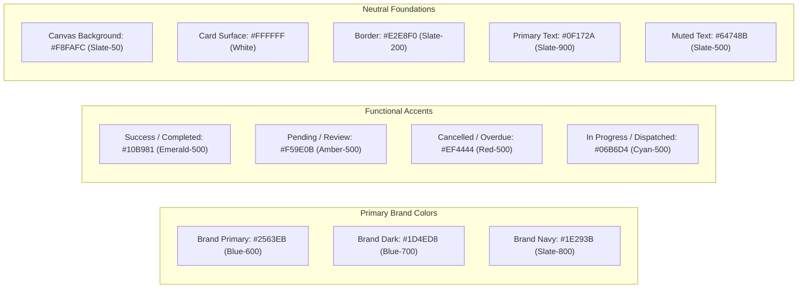

# UI/UX Design System & Interface Specifications
## HomeServe Technologies – Premium Enterprise SaaS Aesthetics

---

## 1. Brand Identity & Design Principles

HomeServe Technologies embodies the qualities of a trusted, modern, mission-critical home services infrastructure platform. The visual language conveys:
- **Trust & Professionalism**: Deep indigo, clean slate, crisp pure white backgrounds.
- **Clarity & Urgency**: Emerald greens for confirmed states and completed jobs; amber for pending alerts; crimson for cancellations.
- **Visual Depth**: Subtle layered borders, soft ambient drop-shadows, and micro-gradients.
- **Accessibility & Focus**: High-contrast typography with clean hierarchical sizing (Inter/Sans-serif font stack).

---

## 2. Color Palette & Token Definitions

---

## 3. Typography Hierarchy

- **Hero & Landing Headings**: `font-extrabold text-4xl lg:text-5xl tracking-tight text-slate-900`
- **Section Headings / Dashboard Titles**: `font-bold text-2xl lg:text-3xl text-slate-900`
- **Card Titles & Table Headers**: `font-semibold text-lg text-slate-800`
- **Body Text**: `font-normal text-sm md:text-base text-slate-600 leading-relaxed`
- **Labels & Microcopy**: `font-medium text-xs uppercase tracking-wider text-slate-400`
- **Financial Monospace**: `font-mono font-bold text-slate-900`

---

## 4. UI Component Library Standards

### 4.1 Buttons
- **Primary**: `bg-blue-600 hover:bg-blue-700 text-white font-medium px-4 py-2.5 rounded-lg shadow-sm hover:shadow transition-all duration-150 flex items-center justify-center gap-2`
- **Secondary / Outline**: `border border-slate-300 hover:bg-slate-50 text-slate-700 font-medium px-4 py-2.5 rounded-lg transition-colors`
- **Danger**: `bg-red-600 hover:bg-red-700 text-white font-medium px-4 py-2.5 rounded-lg shadow-sm`
- **Success / Complete**: `bg-emerald-600 hover:bg-emerald-700 text-white font-medium px-4 py-2.5 rounded-lg shadow-sm`

### 4.2 Status Badges
- `Pending`: `bg-amber-50 text-amber-700 border border-amber-200 px-2.5 py-0.5 rounded-full text-xs font-medium`
- `Confirmed`: `bg-blue-50 text-blue-700 border border-blue-200 px-2.5 py-0.5 rounded-full text-xs font-medium`
- `Provider Assigned`: `bg-indigo-50 text-indigo-700 border border-indigo-200 px-2.5 py-0.5 rounded-full text-xs font-medium`
- `In Progress`: `bg-cyan-50 text-cyan-700 border border-cyan-200 px-2.5 py-0.5 rounded-full text-xs font-medium`
- `Completed`: `bg-emerald-50 text-emerald-700 border border-emerald-200 px-2.5 py-0.5 rounded-full text-xs font-medium`
- `Cancelled` / `Rejected`: `bg-red-50 text-red-700 border border-red-200 px-2.5 py-0.5 rounded-full text-xs font-medium`

### 4.3 Stat Cards
Card with top-line gradient, large metric numeral, trend indicator, and Lucide icon container.

---

## 5. Viewport Breakpoints & Responsive Layout Strategy

- **Mobile ($<768\text{px}$)**:
  - Collapsible drawer sidebar with touch hamburger trigger.
  - Sticky bottom action bars for mobile booking wizard and technician job actions.
  - Horizontal scrolling category pills.
  - Full-width card lists replacing complex tables.
- **Tablet ($768\text{px} - 1024\text{px}$)**:
  - Compact sidebar with icons and hover tooltips.
  - 2-column dashboard metric grids.
- **Desktop ($>1024\text{px}$)**:
  - Fixed 260px left sidebar with nested navigation groups.
  - Multi-column data layouts, responsive tables with sticky headers.
  - Interactive Recharts charts (AreaChart, BarChart, PieChart).
